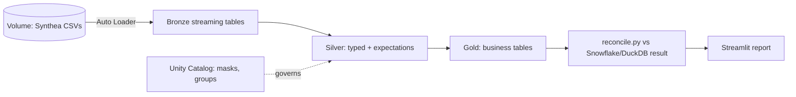

# Patient-360 Lakehouse

**Live report:** https://patient-360-lakehouse.streamlit.app/

The [Patient-360](https://github.com/agshivam/patient-360) hospital platform, rebuilt as a lakehouse on **Databricks** (Free Edition is enough). Same synthetic Synthea data, same gold numbers, a different platform, so the trade-offs are measured instead of argued.

| Layer | File | What it shows |
| --- | --- | --- |
| Bronze | `pipeline/01_bronze.sql` | Incremental ingestion with `read_files`, load time and source file kept |
| Silver | `pipeline/02_silver.sql` | Types, plus expectations that fail the update, drop rows or just count |
| Gold | `pipeline/03_gold.sql` | Same names and numbers as the Snowflake/DuckDB version |
| Governance | `setup/04_governance.sql` | Unity Catalog column mask on SSN, row-filter example |
| Deployment | `databricks.yml` | Asset Bundle: `bundle deploy` creates the pipeline |
| Proof | `scripts/reconcile.py` | Row-by-row match against the reference, exit code 1 on any difference |
| Decision | `docs/ADR-001-snowflake-vs-databricks.md` | When to choose which |

## Status

- Reconciliation logic: tested locally (a deliberately altered table is caught).
- Streamlit report: tested locally.
- Databricks pipeline SQL, bundle and governance: **written but not yet run on a live workspace** (planned for week 5, Databricks Free Edition). This README will be updated with the first real run and any fixes it needed.

See [HOW_TO_RUN.md](HOW_TO_RUN.md). Part of a series of six portfolio projects: https://agshivam.github.io
